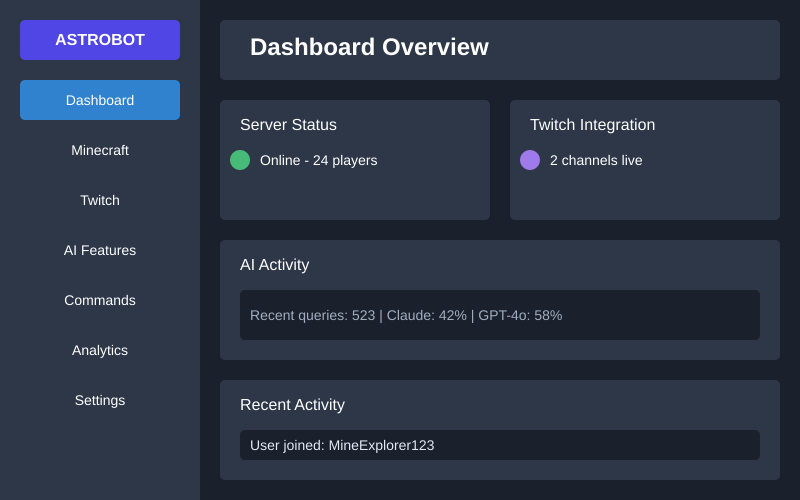

<div align="center">

# 🌟 **AstroBot AI** 🌟


**The AI-Powered Discord Bot for Minecraft & Twitch Communities**


[](https://yourusername.github.io/astrobot/)

<br />
<i>Revolutionize your Discord server with AI-powered solutions</i>
<br /><br />

</div>

<div align="center">

[📚 Documentation](https://yourusername.github.io/astrobot/) •
[💬 Discord](https://discord.gg/astrobot) •
[🎮 Dashboard](https://bot.astroframe.io) •
[❓ Support](https://support.astroframe.io) •
[🛡️ Privacy](https://astroframe.io/privacy)

</div>

---

## ✨ **Features**

<div align="center">
<table>
<tr>
<td align="center" width="33%">
<br/>
<b>Minecraft Integration</b><br/>
<sub>Seamless server management directly from Discord</sub>
</td>
<td align="center" width="33%">
<br/>
<b>AI-Powered Assistance</b><br/>
<sub>Advanced AI with GPT-4o and Claude 3.5</sub>
</td>
<td align="center" width="33%">
<br/>
<b>Twitch Integration</b><br/>
<sub>Transform Discord into a streaming engine</sub>
</td>
</tr>
<tr>
<td align="center" width="33%">
<br/>
<b>Web Dashboard</b><br/>
<sub>Comprehensive control panel</sub>
</td>
<td align="center" width="33%">
<br/>
<b>Customization</b><br/>
<sub>Personalize bot appearance & behavior</sub>
</td>
<td align="center" width="33%">
<br/>
<b>Smart Moderation</b><br/>
<sub>AI-powered community management</sub>
</td>
</tr>
</table>
</div>

## 🚀 **Introduction**

AstroBot AI is a sophisticated Discord bot that revolutionizes Minecraft server management and community engagement through intelligent AI-driven interfaces and automated workflows. Combining state-of-the-art AI models with deep Twitch integration, AstroBot transforms your Discord server into a powerful hub for gaming communities.

### **Key Technologies**

- **AI Integration**: Powered by OpenAI's GPT-4o and Anthropic's Claude 3.5
- **Python Framework**: Built on a robust, scalable Discord bot framework
- **GitHub Automation**: AI-powered issue processing and code improvements
- **Modern Web Stack**: Alpine.js and HTMX for seamless frontend interactions
- **Microservices Architecture**: Designed for reliability and scalability

## 📋 **Getting Started**

### Prerequisites

- Python 3.11 or higher
- Node.js 20 or higher 
- PostgreSQL database
- Discord Bot Token
- Twitch API credentials (for Twitch integration)

### Installation

```bash
# Clone the repository
git clone https://github.com/yourusername/astrobot.git
cd astrobot

# Install dependencies
pip install -r requirements.txt
npm install

# Set up environment variables
cp .env.example .env
# Edit .env with your configuration

# Initialize the database
python -m flask db upgrade

# Start AstroBot
python main.py
```

### Inviting the Bot

1. Create a Discord application and bot in the [Discord Developer Portal](https://discord.com/developers/applications)
2. Enable the necessary intents (Presence, Server Members, Message Content)
3. Use the OAuth2 URL Generator to create an invite link with appropriate permissions
4. Open the generated URL to add AstroBot to your server

## 🎮 **Key Features**

### Minecraft Integration

- **Server Management**: Start, stop, and restart your Minecraft server
- **Player Administration**: Whitelist management, bans, and permissions
- **Server Status**: Real-time monitoring with player counts and performance metrics
- **Console Access**: View and interact with your server console directly from Discord

### AI-Powered Features

- **Intelligent Assistance**: Answer questions about Minecraft, modding, or server management
- **Content Generation**: Create server rules, announcements, and custom commands
- **Image Generation**: Visualize builds and concepts with DALL-E 3 integration
- **Voice Integration**: Generate voiceovers with ElevenLabs for announcements

### Twitch StreamSync

- **Stream Notifications**: Automatic alerts when streamers go live
- **Channel Points**: Integrated point system between Discord and Twitch
- **Chat Bridge**: Synchronized chat between platforms
- **Viewer Rewards**: Automated rewards for loyal community members

### Web Dashboard

- **Intuitive Interface**: Manage all aspects of AstroBot from a modern web dashboard
- **Real-time Analytics**: Track usage, engagement, and community growth
- **User Management**: Comprehensive permission system for team collaboration
- **Theme Customization**: Personalize the dashboard with custom themes

## ✨ **Premium Features**

AstroBot offers enhanced capabilities for premium users:

- **Custom Bot Appearance**: Personalize the bot's name, avatar, and status
- **Advanced Analytics**: Detailed insights into community engagement
- **Expanded AI Usage**: Higher limits for AI-powered features
- **Priority Support**: Direct access to the development team
- **Early Access**: Be the first to try new features

## 📊 **Dashboard Demo**

<div align="center">

</div>

## 🧩 **Commands**

Here are some of the most useful commands available in AstroBot:

```
!help              - Show help message
!mc status         - Check Minecraft server status
!mc whitelist add  - Add player to whitelist
!twitch link       - Link your Twitch channel
!ask               - Ask the AI a question
!points            - Check your points balance
!custom            - Manage custom commands
```

For a complete command list, check our [documentation](https://x-niter.github.io/astrobot/user-guide).

## 📚 **Documentation**

Comprehensive documentation is available at [https://yourusername.github.io/astrobot/](https://yourusername.github.io/astrobot/)

Our documentation includes:
- [Getting Started Guide](https://yourusername.github.io/astrobot/getting-started)
- [User Guide](https://yourusername.github.io/astrobot/user-guide)
- [API Reference](https://yourusername.github.io/astrobot/api-reference)
- [AI Integrations](https://yourusername.github.io/astrobot/ai-integrations)
- [Troubleshooting](https://yourusername.github.io/astrobot/troubleshooting)

## 🛠️ **Development**

AstroBot uses innovative AI-powered GitHub workflows for development:

- **Automated Issue Processing**: AI analysis of bugs and feature requests
- **Self-healing Code**: Automatic fixes for common issues
- **Code Review**: AI-assisted code reviews for quality assurance
- **Documentation Generation**: AI-enhanced documentation updates

Learn more about our [AI workflows](https://yourusername.github.io/astrobot/ai-workflows).

## 🔍 **Health Monitoring & Production Reliability**

AstroBot includes a comprehensive health monitoring system for production environments:

- **HTTP Health Check Endpoint**: RESTful API at `/health` providing detailed status information
- **Database Monitoring**: Real-time PostgreSQL and MongoDB connection status and metrics
- **System Resource Tracking**: Disk space, memory usage, and uptime statistics
- **Self-healing Capabilities**: Automated recovery from common failure scenarios
- **Command Line Tools**: Shell-based monitoring with `health_check.sh` for easy integration

For production deployments, we provide:

- **Systemd Integration**: Service files with automatic restart capabilities
- **Scheduled Health Checks**: Automated monitoring via systemd timers
- **Graceful Shutdown**: Proper resource cleanup during service termination
- **Backup Management**: Database backup tools with disaster recovery support
- **Deployment Automation**: Streamlined installation with the `deploy.py` script

See [PRODUCTION.md](PRODUCTION.md) for detailed deployment and monitoring instructions.

## 👥 **Contributing**

We welcome contributions from the community! Please check our [Contributing Guide](CONTRIBUTING.md) for details on how to get involved.

## 📝 **Changelog**

See [CHANGELOG.md](CHANGELOG.md) for a history of changes and improvements.

## 📜 **License**

AstroBot is released under the MIT License. See [LICENSE](LICENSE) for details.

## 🙏 **Acknowledgements**

- [Discord.py](https://github.com/Rapptz/discord.py) - The foundation of our bot
- [Flask](https://flask.palletsprojects.com/) - Powers our web dashboard
- [Alpine.js](https://alpinejs.dev/) and [HTMX](https://htmx.org/) - Frontend magic
- [OpenAI](https://openai.com/) and [Anthropic](https://www.anthropic.com/) - AI capabilities
- [Twitch API](https://dev.twitch.tv/) - Streaming integration

---

<div align="center">

**Made with ❤️ by the AstroFrame Team**

<a href="https://astroframe.io">

</a>

</div>
